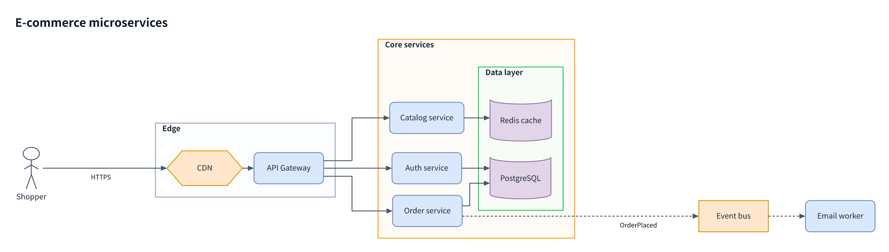

# vsdx-kit

**Generate real, native Microsoft Visio `.vsdx` files — without Visio and without a browser.**

Describe a diagram as JSON (or hand over a draw.io file) and get an editable Visio drawing with real shapes, glued connectors, text, containers and embedded images. CLI, Node.js library and MCP server for AI agents.

[](https://www.npmjs.com/package/vsdx-kit)
[](https://github.com/TopLocalAI/vsdx-kit/actions/workflows/ci.yml)
[](LICENSE)

English · [简体中文](README.zh-CN.md)



<sub>Preview of [`examples/microservices.json`](examples/microservices.json). The `.vsdx` it produces is [`examples/output/microservices.vsdx`](examples/output/microservices.vsdx).</sub>

## Why

- **Native `.vsdx`** — Open Packaging (OPC) files that Microsoft Visio opens as ordinary drawings: real shapes you can restyle, connectors glued to shapes (they follow when you move a box), text you can edit.
- **Offline and headless** — pure Node.js. No Visio, no Office, no headless Chrome, no network. Works in CI, servers and containers.
- **Automatic layout** — you list nodes and edges; [ELK](https://eclipse.dev/elk/) places them and routes orthogonal connectors. Groups become containers.
- **draw.io → Visio** — converts `.drawio` / diagrams.net files (plain or compressed, all pages) keeping geometry, colours, labels and embedded images.
- **Built for AI agents** — a tiny, documented JSON format with a [JSON Schema](schema/diagram.schema.json), and a local MCP server so Claude, Cursor and other agents can write Visio files.
- **CJK ready** — Chinese/Japanese/Korean text is measured with a bundled Noto Sans SC font, so labels fit their shapes.

## Quick start

```bash
npx vsdx-kit convert examples/order-flow.json -o order-flow.vsdx
npx vsdx-kit convert my-diagram.drawio            # → my-diagram.vsdx (all pages)
npx vsdx-kit preview examples/order-flow.json -o order-flow.png
```

Install it in a project:

```bash
npm i vsdx-kit        # or: pnpm add vsdx-kit / yarn add vsdx-kit
```

Requires Node.js 18 or newer.

## CLI

```text
vsdx-kit convert <input.json|input.drawio> [-o out.vsdx] [--format vsdx|png|svg|drawio]
vsdx-kit preview <input.json|input.drawio> [-o out.png]
vsdx-kit inspect <file.vsdx>        # page names, shape / connector counts
vsdx-kit schema                     # print the JSON Schema
vsdx-kit mcp                        # start the MCP server on stdio
```

| Option | Meaning |
| --- | --- |
| `-o, --output <file>` | Output file. The format follows the extension unless `--format` is given. Default: next to the input. |
| `-f, --format <fmt>` | `vsdx` (default for `convert`), `png` (default for `preview`), `svg`, `drawio` |
| `--page <n>` | Only page *n* (1-based) of a multi-page draw.io / JSON file |
| `--direction <dir>` | JSON input: `right`, `down`, `left` or `up` (overrides the file) |
| `--scale <n>` | PNG scale factor (default 2) |
| `--ai` | Send pictures / text to the [VSDX.ai API](#pictures-text-and-documents--visio) (needs `VSDX_AI_API_KEY`) |

## JSON format

```json
{
  "title": "Order flow",
  "direction": "right",
  "nodes": [
    { "id": "start", "label": "Order received", "shape": "ellipse" },
    { "id": "check", "label": "In stock?", "shape": "diamond" },
    { "id": "ship", "label": "Ship", "group": "wh" },
    { "id": "db", "label": "Orders DB", "shape": "cylinder", "group": "wh" }
  ],
  "edges": [
    { "from": "start", "to": "check" },
    { "from": "check", "to": "ship", "label": "yes" },
    { "from": "ship", "to": "db", "dashed": true, "arrow": "both" }
  ],
  "groups": [{ "id": "wh", "label": "Warehouse" }]
}
```

**Diagram**

| Field | Type | Notes |
| --- | --- | --- |
| `title` | string | Drawn above the diagram; also the Visio page name |
| `direction` | `right` \| `down` \| `left` \| `up` | Main flow direction. Default `right` |
| `nodes` | Node[] | At least one |
| `edges` | Edge[] | Optional |
| `groups` | Group[] | Optional containers |

A JSON **array** of diagrams becomes a multi-page Visio document ([example](examples/multi-page.json)).

**Node**

| Field | Type | Notes |
| --- | --- | --- |
| `id` | string | Unique, referenced by edges |
| `label` | string | Use `\n` for line breaks |
| `shape` | `rect` `roundedRect` `ellipse` `circle` `diamond` `cylinder` `hexagon` `note` `actor` `text` `image` | Default `roundedRect` |
| `fill`, `stroke`, `fontColor` | `#RRGGBB` \| `#RGB` \| `none` | Default palette per shape |
| `fontSize` | number (px) | Default 13 |
| `bold`, `dashed` | boolean | |
| `group` | string | Id of the containing group |
| `image` | string | For `shape: "image"`: a `data:` URI (PNG, JPEG or SVG). In the CLI and MCP server a local file path also works |
| `width`, `height` | number (px) | Fix the size instead of fitting the text |

**Edge** — `from`, `to` (node ids), `label`, `dashed`, `arrow` (`end` default, `start`, `both`, `none`), `color`, optional `id`.

**Group** — `id`, `label`, `fill`, `stroke`, `parent` (id of an enclosing group, for nesting).

The full machine-readable definition is [`schema/diagram.schema.json`](schema/diagram.schema.json) (also exported as `vsdx-kit/schema.json`). Add `"$schema"` to your file for editor completion.

## Library

```ts
import { writeFileSync, readFileSync } from "node:fs";
import { jsonToVsdx, drawioToVsdx, jsonToDrawio, toPng, toSvg, inspectVsdx } from "vsdx-kit";

const vsdx = await jsonToVsdx({
  title: "Hello Visio",
  nodes: [{ id: "a", label: "Hello" }, { id: "b", label: "Visio", shape: "ellipse" }],
  edges: [{ from: "a", to: "b" }],
});
writeFileSync("hello.vsdx", vsdx);

writeFileSync("flow.vsdx", await drawioToVsdx(readFileSync("flow.drawio", "utf8")));
writeFileSync("hello.png", await toPng({ nodes: [{ id: "x", label: "Preview" }] }));
console.log(await inspectVsdx(vsdx)); // { pages: [...], shapes: 2, connectors: 1 }
```

| Function | Returns |
| --- | --- |
| `jsonToVsdx(diagram \| diagram[], opts?)` | `Promise<Uint8Array>` — `.vsdx` bytes |
| `drawioToVsdx(xml, { pages?: "all" \| index, onWarning? })` | `Promise<Uint8Array>` |
| `jsonToDrawio(diagram \| diagram[], opts?)` | `Promise<string>` — editable draw.io XML |
| `toSvg(diagramOrDrawioXml, { page? })` | `Promise<string>` |
| `toPng(diagramOrDrawioXml, { page?, scale?, background? })` | `Promise<Uint8Array>` |
| `inspectVsdx(bytes)` | page names, shape / connector / glue / image counts |
| `parseDiagram(json)`, `diagramSchema`, `diagramJsonSchema()` | validation (zod) and JSON Schema |
| `layoutDiagram`, `writeVsdx`, `renderSvg`, `renderPng`, `placedToDrawio` | lower-level building blocks working on absolute geometry |

`opts` accepts `direction`, `nodeSpacing` and `layerSpacing`. ESM only, with TypeScript types.

## MCP server (Claude, Cursor, other agents)

`vsdx-kit mcp` runs a local [Model Context Protocol](https://modelcontextprotocol.io) server over stdio. Tools:

| Tool | What it does |
| --- | --- |
| `create_vsdx_from_json` | Lays out a JSON diagram and writes a `.vsdx` (optionally a PNG preview). Returns the path and shape/connector counts. |
| `convert_drawio_to_vsdx` | Converts a `.drawio` file or XML string to `.vsdx`. |
| `ai_generate_diagram`, `ai_convert_image_to_vsdx` | Only when `VSDX_AI_API_KEY` is set — see [below](#pictures-text-and-documents--visio). |

**Claude Code**

```bash
claude mcp add vsdx-kit -- npx -y vsdx-kit mcp
```

**Cursor** (`~/.cursor/mcp.json`), **Claude Desktop** (`claude_desktop_config.json`) and most other clients:

```json
{
  "mcpServers": {
    "vsdx-kit": {
      "command": "npx",
      "args": ["-y", "vsdx-kit", "mcp"]
    }
  }
}
```

Then ask: *“Draw our checkout flow as a Visio file in docs/checkout.vsdx.”* Relative paths are resolved against the server's working directory.

## Examples

| Input | Preview | What it shows |
| --- | --- | --- |
| [`order-flow.json`](examples/order-flow.json) | [png](docs/examples/order-flow.png) | Flowchart with decisions, labels, a dashed branch |
| [`zh-approval.json`](examples/zh-approval.json) | [png](docs/examples/zh-approval.png) | Chinese labels, top-down flow |
| [`microservices.json`](examples/microservices.json) | [png](docs/examples/microservices.png) | Nested groups (containers), cylinders, hexagon, actor |
| [`org-chart.json`](examples/org-chart.json) | [png](docs/examples/org-chart.png) | Org chart, custom colours, no arrowheads |
| [`cloud-icons.json`](examples/cloud-icons.json) | [png](docs/examples/cloud-icons.png) | Embedded images (SVG icons) with captions |
| [`multi-page.json`](examples/multi-page.json) | [png](docs/examples/multi-page.png) | Two diagrams → two Visio pages |
| [`network-zh.drawio`](examples/network-zh.drawio) | [png](docs/examples/network-zh.png) | draw.io with a swimlane container, waypoints, Chinese text |
| [`two-pages-compressed.drawio`](examples/two-pages-compressed.drawio) | [png](docs/examples/two-pages-compressed.png) | Compressed multi-page draw.io with embedded PNG/SVG images |

Ready-made `.vsdx` outputs are in [`examples/output`](examples/output). Regenerate with `pnpm examples`.

## Pictures, text and documents → Visio

vsdx-kit is the open **format layer**: it turns *structured* input into Visio. Turning a **screenshot, whiteboard photo, PDF or a paragraph of text** into a diagram needs AI, which vsdx-kit does not do offline. When you pass such a file, the CLI says so and exits.

For that, use [VSDX.ai](https://vsdx.ai/?utm_source=vsdx-kit) — the AI Visio generator from the same team ([image to Visio](https://vsdx.ai/tools/image-to-visio?utm_source=vsdx-kit), free credits for new accounts). With an API key ([create one](https://vsdx.ai/settings/apikeys?utm_source=vsdx-kit)) vsdx-kit can call its public API for you:

```bash
export VSDX_AI_API_KEY=vsdx_...
npx vsdx-kit convert whiteboard.jpg --ai -o whiteboard.vsdx      # picture → editable Visio
npx vsdx-kit convert notes.md --ai -o notes.vsdx                 # text file → diagram
npx vsdx-kit generate "OAuth login sequence with refresh tokens" -o oauth.vsdx --type flowchart
```

With the key set, the MCP server also offers `ai_generate_diagram` and `ai_convert_image_to_vsdx`. These calls use credits on your VSDX.ai account. Without `--ai` / the key, vsdx-kit never contacts any server.

### vsdx-kit vs VSDX.ai

| | vsdx-kit (this repo) | [VSDX.ai](https://vsdx.ai/?utm_source=vsdx-kit) |
| --- | --- | --- |
| JSON → native `.vsdx` | ✅ offline | ✅ |
| draw.io → `.vsdx` | ✅ offline | ✅ |
| Picture / screenshot → editable Visio | — | ✅ [image to Visio](https://vsdx.ai/tools/image-to-visio?utm_source=vsdx-kit) |
| Text / documents → diagram | — | ✅ |
| Online editor, revisions, team use | — | ✅ |
| CLI, Node library, local MCP server | ✅ | REST API + hosted MCP ([developers](https://vsdx.ai/developers?utm_source=vsdx-kit)) |
| Price | free, MIT | free credits, then paid plans |

## Compatibility

- **Microsoft Visio** 2013 and later: files use the standard Visio 2013 `.vsdx` package format and open as normal drawings.
- **LibreOffice Draw** opens and exports them (tested with `soffice --headless --convert-to png`; [result](docs/libreoffice-render.png)).
- **draw.io / diagrams.net** can import `.vsdx`.
- On **macOS**, where Visio is not available, you can view `.vsdx` files with [vsdx.app](https://vsdx.app) or LibreOffice.
- Shapes use built-in geometry (no stencils needed); connectors use Visio's Dynamic Connector master and are glued (`Connects`) to their shapes. Text uses the *Microsoft YaHei* font name, which Visio substitutes where it is missing.

## Limitations

- Auto-layout is ELK's layered algorithm with default-ish settings: good for flowcharts, pipelines, org charts and architecture overviews; dense graphs may get long detours. Use draw.io (or fixed coordinates via the lower-level API) when you need pixel control.
- No swimlane auto-layout yet (groups are laid out as containers).
- draw.io stencil shapes (`mxgraph.*` — AWS, Cisco, BPMN …) become labelled placeholders; remote image URLs are not downloaded.
- Images must be PNG, JPEG or SVG (SVG is rasterized).
- The npm package is ~15 MB because it bundles Noto Sans SC (used for text measurement and previews).
- No Visio → JSON/draw.io reader.

## Privacy

No telemetry, no watermarks, no network access in offline mode. Only `--ai` / the AI MCP tools talk to `vsdx.ai`, and only when you set `VSDX_AI_API_KEY`.

## Development

```bash
pnpm install
pnpm test        # vitest
pnpm build       # tsc → dist/
pnpm lint        # biome
pnpm examples    # regenerate examples/output and docs/examples
pnpm schema      # regenerate schema/diagram.schema.json
```

## Related

- [awesome-visio](https://github.com/TopLocalAI/awesome-visio) — a curated list of Visio tools, libraries and resources.

## License

[MIT](LICENSE) © 2026 TopLocalAI. Bundled Noto Sans SC fonts are under the [SIL Open Font License 1.1](assets/fonts/OFL-NotoSansCJK.txt).
