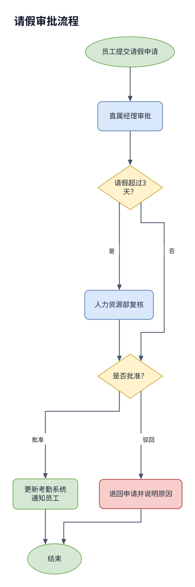

# vsdx-kit

**不用安装 Visio、也不用浏览器，直接生成真正的 Microsoft Visio `.vsdx` 原生文件。**

用 JSON 描述一张图（或者直接给一个 draw.io 文件），得到可编辑的 Visio 图：真实形状、粘连在形状上的连接线、文字、容器和内嵌图片。提供命令行、Node.js 库，以及给 AI Agent 用的 MCP 服务。

[English](README.md) · 简体中文



## 特点

- **原生 `.vsdx`**：标准 OPC 包，Visio 当作普通图打开；形状可改样式，连接线粘在形状上（拖动形状时跟着走），文字可编辑。
- **离线、无界面**：纯 Node.js，不需要 Visio、Office、无头浏览器，也不联网。CI、服务器、容器里都能跑。
- **自动布局**：只写节点和连线，[ELK](https://eclipse.dev/elk/) 负责摆放并画正交连线；分组变成容器。
- **draw.io → Visio**：支持 `.drawio` / diagrams.net 文件（压缩或不压缩、多页），保留位置、颜色、文字和内嵌图片。
- **适合 AI Agent**：格式小而稳定，带 [JSON Schema](schema/diagram.schema.json)；本地 MCP 服务让 Claude、Cursor 等直接写 Visio 文件。
- **中文友好**：内置思源黑体（Noto Sans SC）做文字测量，中文标签能放进形状里。

## 快速开始

```bash
npx vsdx-kit convert examples/zh-approval.json -o 请假审批.vsdx
npx vsdx-kit convert 我的图.drawio              # → 我的图.vsdx（所有页）
npx vsdx-kit preview examples/zh-approval.json -o 预览.png
```

在项目里安装：

```bash
npm i vsdx-kit
```

需要 Node.js 18 及以上。

## 命令行

```text
vsdx-kit convert <输入.json|输入.drawio> [-o 输出.vsdx] [--format vsdx|png|svg|drawio]
vsdx-kit preview <输入> [-o 输出.png]
vsdx-kit inspect <文件.vsdx>        # 页名、形状数、连接线数
vsdx-kit schema                     # 输出 JSON Schema
vsdx-kit mcp                        # 以 stdio 启动 MCP 服务
```

常用参数：`-o` 输出文件（按扩展名决定格式）、`--format`、`--page <n>`（只转第 n 页）、`--direction right|down|left|up`、`--scale`（PNG 倍率，默认 2）、`--ai`（见下文）。

## JSON 格式

```json
{
  "title": "订单流程",
  "direction": "down",
  "nodes": [
    { "id": "s", "label": "收到订单", "shape": "ellipse" },
    { "id": "c", "label": "有库存？", "shape": "diamond" },
    { "id": "ship", "label": "发货", "group": "wh" },
    { "id": "db", "label": "订单库", "shape": "cylinder", "group": "wh" }
  ],
  "edges": [
    { "from": "s", "to": "c" },
    { "from": "c", "to": "ship", "label": "是" },
    { "from": "ship", "to": "db", "dashed": true }
  ],
  "groups": [{ "id": "wh", "label": "仓库" }]
}
```

- **图**：`title`（标题，也是 Visio 页名）、`direction`（默认 `right`）、`nodes`、`edges`、`groups`。传一个**数组**就生成多页 Visio 文档。
- **节点**：`id`、`label`（`\n` 换行）、`shape`（`rect` `roundedRect` `ellipse` `circle` `diamond` `cylinder` `hexagon` `note` `actor` `text` `image`，默认 `roundedRect`）、`fill` / `stroke` / `fontColor`（`#RRGGBB`）、`fontSize`、`bold`、`dashed`、`group`、`image`（`data:` URI；命令行和 MCP 里也可以写本地文件路径）、`width` / `height`。
- **连线**：`from`、`to`、`label`、`dashed`、`arrow`（`end` 默认 / `start` / `both` / `none`）、`color`。
- **分组**：`id`、`label`、`fill`、`stroke`、`parent`（嵌套分组）。

完整定义见 [`schema/diagram.schema.json`](schema/diagram.schema.json)。

## 作为库使用

```ts
import { writeFileSync } from "node:fs";
import { jsonToVsdx, drawioToVsdx, toPng } from "vsdx-kit";

writeFileSync("hello.vsdx", await jsonToVsdx({
  nodes: [{ id: "a", label: "你好" }, { id: "b", label: "Visio", shape: "ellipse" }],
  edges: [{ from: "a", to: "b" }],
}));
```

主要函数：`jsonToVsdx`、`drawioToVsdx`、`jsonToDrawio`、`toSvg`、`toPng`、`inspectVsdx`、`parseDiagram`。详见[英文文档](README.md#library)。

## MCP 服务

```bash
claude mcp add vsdx-kit -- npx -y vsdx-kit mcp
```

Cursor（`~/.cursor/mcp.json`）/ Claude Desktop：

```json
{ "mcpServers": { "vsdx-kit": { "command": "npx", "args": ["-y", "vsdx-kit", "mcp"] } } }
```

工具：`create_vsdx_from_json`（JSON → .vsdx，可附带 PNG 预览）、`convert_drawio_to_vsdx`。设置了 `VSDX_AI_API_KEY` 时另有 `ai_generate_diagram`、`ai_convert_image_to_vsdx`。

## 图片、文字、文档 → Visio

vsdx-kit 只负责“格式层”：把**结构化**输入变成 Visio。把**截图、白板照片、PDF 或一段文字**变成图需要 AI 识别，vsdx-kit 离线做不了；遇到这类文件，命令行会直接说明并退出。

这类需求可以用同一团队的 [VSDX.ai](https://vsdx.ai/?utm_source=vsdx-kit)（[图片转 Visio](https://vsdx.ai/tools/image-to-visio?utm_source=vsdx-kit)，新用户有免费额度）。有 API key（[在这里创建](https://vsdx.ai/settings/apikeys?utm_source=vsdx-kit)）时，vsdx-kit 可以替你调用它的公开 API：

```bash
export VSDX_AI_API_KEY=vsdx_...
npx vsdx-kit convert 白板.jpg --ai -o 白板.vsdx
npx vsdx-kit generate "带刷新令牌的 OAuth 登录流程" -o oauth.vsdx
```

| | vsdx-kit（本仓库） | [VSDX.ai](https://vsdx.ai/?utm_source=vsdx-kit) |
| --- | --- | --- |
| JSON → `.vsdx` | ✅ 离线 | ✅ |
| draw.io → `.vsdx` | ✅ 离线 | ✅ |
| 图片 / 截图 → 可编辑 Visio | — | ✅ |
| 文字 / 文档 → 图 | — | ✅ |
| 在线编辑、团队协作 | — | ✅ |
| 价格 | 免费，MIT | 免费额度，之后付费 |

## 兼容性与限制

- Microsoft Visio 2013 及以上、LibreOffice Draw 可以打开（已用 `soffice --headless` 验证，[效果](docs/libreoffice-render.png)）；draw.io 可导入 `.vsdx`。macOS 上没有 Visio，可用 [vsdx.app](https://vsdx.app) 或 LibreOffice 查看。
- 自动布局使用 ELK 分层算法，适合流程图、组织架构图、架构草图；很密的图可能绕线较长。
- 暂不支持泳道自动布局；draw.io 的 `mxgraph.*` 图标库形状会变成带文字的占位框；远程图片 URL 不下载。
- npm 包约 15 MB（内置字体）。
- 不收集任何数据、不加水印；只有使用 `--ai` 并设置 key 时才会访问 vsdx.ai。

## 相关

- [VSDX.ai](https://vsdx.ai/?utm_source=vsdx-kit)：AI 生成 Visio，文字、图片、文档转可编辑 `.vsdx`。
- [LayerBack VSDX 在线查看器](https://layerback.com/vsdx-viewer?utm_source=vsdx-kit)：没装 Visio 时，免费在浏览器里打开 vsdx-kit 生成的文件。
- [LayerBack](https://layerback.com/?utm_source=vsdx-kit)：把图表图片或 PDF 还原成可编辑的 VSDX、PPTX、draw.io 或 SVG。
- [awesome-visio](https://github.com/TopLocalAI/awesome-visio)

## 许可证

[MIT](LICENSE) © 2026 TopLocalAI。内置 Noto Sans SC 字体采用 [SIL OFL 1.1](assets/fonts/OFL-NotoSansCJK.txt)。
